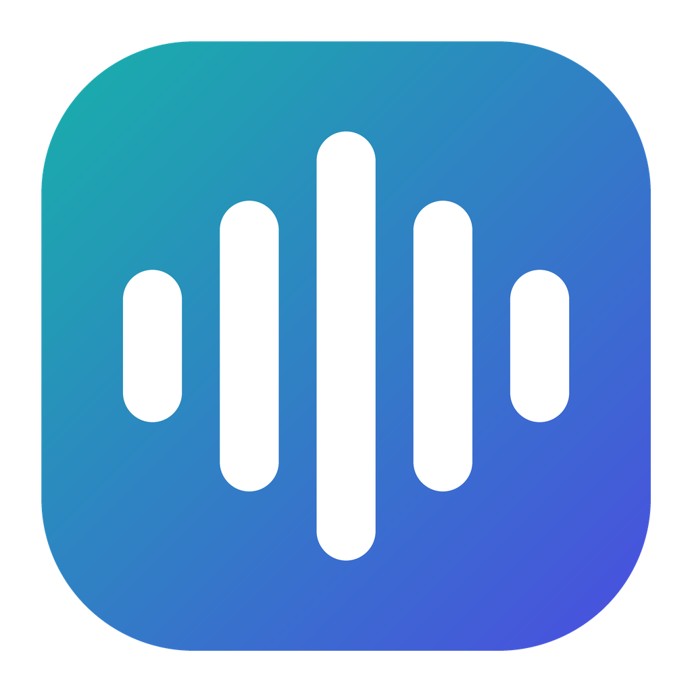

<p align="center">
  
</p>

<h1 align="center">Voice Studio Box</h1>

<p align="center">Clone giọng, đọc văn bản tiếng Việt và lồng tiếng video, chạy ngay trên máy của bạn.</p>

<p align="center">
  <a href="https://colab.research.google.com/github/Tran-Van-Hieu/VoiceStudioBox/blob/main/colab/VoiceStudioBox.ipynb"></a>
</p>

## Tính năng

Thanh bên có 5 mục:

| Mục | Làm gì |
|---|---|
| **Thư viện giọng** | Giọng đã clone, tìm kiếm, lọc. Nút **Clone giọng** nhận file audio hoặc video bất kỳ độ dài: tách giọng khỏi nhạc nền, khử nhiễu, kéo chọn đoạn mẫu trên sóng âm, Whisper tự chép lời. |
| **Tạo âm thanh** | 4 chế độ: **Một bản**, **Kịch bản dài** (tự tách đoạn trọn câu, tải ZIP hoặc 1 file gộp), **Hàng loạt** (`.txt`, `.csv`), **Nhiều giọng** (mỗi đoạn một giọng, cảm xúc, tốc độ, khoảng nghỉ, nhạc nền). |
| **Lồng tiếng** | Tách giọng, chép lời, nhận biết người nói, dịch có ngữ cảnh, đọc lại, ghép video. Chế độ **Chỉ chép lời** xuất SRT, TXT. |
| **Lịch sử** | Tìm có dấu hoặc không dấu, lọc, ghim, xuất ZIP. |
| **Cài đặt** | 4 tab: Chung, Giọng đọc, Model & GPU, Nâng cao. |

Mẹo khi viết kịch bản:

- Đổi cảm xúc giữa bài: `[vui] Hôm nay thật tuyệt. [buồn] Nhưng trời lại mưa.`
- Chèn khoảng nghỉ: `[dừng 3s]` hoặc `[nghỉ 2-5s]`.
- Kịch bản nhiều giọng: `Tên: lời thoại`, tên trùng với giọng trong Thư viện được gán tự động.

Mỗi đoạn được Whisper nghe lại, chấm độ giống giọng, dò tiếng click và tạp âm, lỗi thì tự tạo lại. Bấm **Bỏ kiểm tra** để nhận ngay bản đang có, **Dừng ngay** để dừng. Kiểm tra tự động không bắt chắc chắn lỗi sai dấu thanh, nên vẫn cần nghe lại.

## Model

| Model | Tiếng Việt | VRAM | Ghi chú |
|---|---|---|---|
| OmniVoice | Có | khoảng 3 GB | Nhanh nhất, nên dùng. Chỉ dùng **phi thương mại** (CC-BY-NC). |
| Qwen3-TTS 1.7B / 0.6B | Có | 4–6 GB | Đọc theo đoạn khoảng 20 giây để giọng không bị lệch. |
| Chatterbox đa ngôn ngữ | Có | khoảng 4 GB | |
| Whisper | Chép lời | 1–3 GB | Tự rời bộ nhớ sau 1 phút không dùng. |
| Qwen3 1.7B / 4B | Dịch | 2–7 GB | Dùng cho lồng tiếng. |

Tốc độ đo trên RTX 4060 8 GB: OmniVoice tạo 1 phút âm thanh trong khoảng 10–18 giây.

## Chạy ở đâu

### Máy Windows có card NVIDIA

Cài bản build (`tauri\src-tauri\target\release\bundle\nsis\`), hoặc build từ mã nguồn (xem cuối trang).

### Máy không có card màn hình

1. **Dùng máy có GPU làm server.** Trên máy yếu, mở app → Cài đặt → Địa chỉ server, nhập địa chỉ máy có GPU. Hai máy ở xa nhau thì dùng Tailscale. Không mở server ra internet công khai, vì server không có mật khẩu.
2. **Google Colab (GPU T4 miễn phí).** Bấm nút **Open in Colab** ở đầu trang, rồi làm theo hướng dẫn trong notebook. Xem thêm mục bên dưới.
3. **Chỉ dùng CPU** qua Docker: `docker compose up --build`, rồi mở `http://localhost:17600`. Chậm: CPU 12 nhân cần khoảng 5–9 phút cho 1 phút âm thanh, và cần ít nhất 8 GB RAM.

### Google Colab

1. Mở [notebook](https://colab.research.google.com/github/Tran-Van-Hieu/VoiceStudioBox/blob/main/colab/VoiceStudioBox.ipynb). Cần đăng nhập Google.
2. **Thời gian chạy → Thay đổi loại thời gian chạy → T4 GPU → Lưu.**
3. Bấm ▶. Nếu chọn lưu vào Google Drive, Colab sẽ hỏi quyền truy cập Drive: chọn tài khoản và tick **Chọn tất cả**.
4. Chờ cho đến khi hiện `https://….trycloudflare.com`, rồi mở link đó. App chạy ngay trong trình duyệt.
5. Lần đầu, app tải sẵn OmniVoice và Qwen3-TTS 1.7B rồi lưu vào thư mục `VoiceStudioBox-cache` trên Drive (khoảng 10 GB, cùng thư viện đã cài và giao diện đã build). Các lần sau chép từ Drive về, không tải lại.
6. Mỗi lần mở, app kiểm tra bản mới của model và báo trong log. Muốn cập nhật thì vào **Cài đặt → Model**, nếu không thì app giữ bản đang dùng.

Lưu và chia sẻ:

- Giọng đã clone và lịch sử được sao lưu vào thư mục `VoiceStudioBox` trong Google Drive mỗi phút và khi bấm ■. Lần mở sau app tự chép về.
- Link được ghi vào `VoiceStudioBox/link.txt`. Ai có link đều dùng được đầy đủ app và các giọng của bạn, kể cả xóa: chỉ gửi người tin cậy.
- Link chỉ chạy khi Colab của bạn đang chạy, và đổi mỗi lần mở.
- Colab miễn phí tự ngắt khi để không lâu hoặc chạy quá vài giờ.

Trên máy ảo hoặc Kaggle, chạy từ thư mục mã nguồn:

```bash
python scripts/remote_server.py
```

## Build từ mã nguồn (Windows)

Cần Python 3.12, Bun, Rust và [just](https://github.com/casey/just).

```powershell
just setup
just build-local
```

Tắt app trước khi build. File cài nằm ở `tauri\src-tauri\target\release\bundle\nsis\`.

Kiểm thử:

```powershell
backend\venv\Scripts\python -m pytest backend\tests
python scripts\smoke_test.py --url http://127.0.0.1:17493 --engine omnivoice --language vi
```

## Dùng có trách nhiệm

Chỉ clone giọng của chính bạn hoặc người đã đồng ý. Không dùng để giả mạo, lừa đảo hay gây hiểu lầm. Kiểm tra giấy phép của từng model trước khi dùng cho mục đích thương mại.

## Giấy phép

MIT, xem [LICENSE](LICENSE). Mỗi model có giấy phép riêng.
